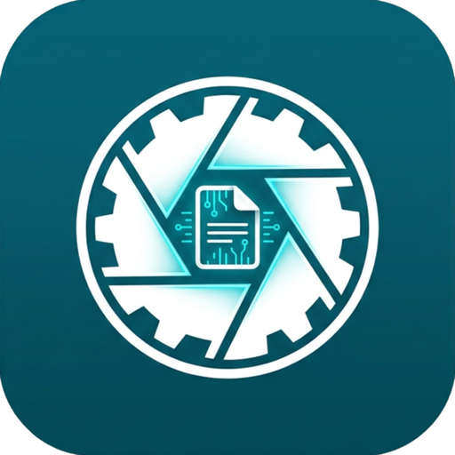

<p align="center">
  
</p>

<h1 align="center">ScanCraft</h1>

<p align="center">
  <strong>High-Performance, Privacy-First, 100% Offline Document Scanner for Android</strong>
</p>

<p align="center">
  <a href="LICENSE"></a>
  <a href="https://github.com/krinry/ScanCraft/actions"></a>
  <a href="https://android.com"></a>
  <a href="https://kotlinlang.org"></a>
  <a href="https://developer.android.com/jetpack/compose"></a>
</p>

---

## 🌟 Overview

**ScanCraft** (`com.krinry.scancraft`) is a modern, fully open-source, offline document scanner app built with Jetpack Compose, CameraX, and high-performance native C++ algorithms. 

Engineered with privacy as its primary tenet, **ScanCraft contains zero analytics, zero ad SDKs, zero user tracking beacons, and requires zero cloud subscriptions**. Every scan, document image, and OCR query remains strictly on your local device.

---

## 🚀 Key Features

### 📷 1. Intelligent Camera Viewfinder (CameraX)
* **Real-time Quad Detection:** Live 60fps document boundary detection with green tracking overlays.
* **Smart Flash & Focus:** Torch controls (Off, On, Auto), touch-to-focus, and rule-of-thirds grid guides.
* **Specialized Capture Modes:**
  * **Single Mode:** Instant auto-capture on document stabilization.
  * **Batch Mode:** Rapid shutter burst for digitizing entire books, receipts, and multi-page documents.
  * **ID Card Mode:** Automated dual-sided card capture composited onto a single A4 page.
  * **QR & Barcode Mode:** Live code scanning with instant preview and actionable triggers.
  * **Book Mode:** Dual-page split with automatic curvature correction.

### 📐 2. Precision Crop & Perspective Warp
* **8-Point Quad Editor:** 4 corner handles and 4 midpoint handles for millimeter-accurate boundaries.
* **Floating Loupe:** High-magnification crosshair magnifying glass hovering above the finger for exact edge alignment.
* **Hardware-Accelerated Homography:** Native C++ perspective warp for crisp, distortion-free output.

### 🎨 3. Clean-Room Computer Vision Filters
* **Magic Color:** CLAHE adaptive local contrast enhancement + background whitening + saturation boost.
* **B&W / B&W 2:** Bradley-Roth & Sauvola adaptive binarization for razor-sharp text contrast.
* **Grayscale & Lighten:** Monochromatic shadow-eliminated document rendering.
* **Manual Sliders:** Granular Brightness and Contrast controls (-100 to +100).

### 📑 4. Comprehensive PDF Studio & Document Management
* **Flexible Page Sizes:** Export documents to **A4**, **US Letter**, **US Legal**, or **Fit to Image**.
* **Compression Control:** Customizable quality presets (Low, Medium, High).
* **Security & Watermarks:** Add custom diagonal/repeating watermarks and AES-128 password encryption.
* **Vector Drawing & Signatures:** Add, position, resize, and save handwritten digital signatures using AndroidX Ink and ThorVG vector rendering.

### 🔍 5. On-Device Multi-Language OCR (Google ML Kit)
* 100% offline text extraction with zero network latency.
* Multi-script recognition: Latin, Devanagari, Chinese, and Japanese.
* One-tap copy to clipboard and text search.

### ☁️ 6. Universal Cloud & Local SAF Sync
* Synchronize encrypted backups with Google Drive, Dropbox, Microsoft OneDrive, and WebDAV servers.
* Android Storage Access Framework (SAF) integration for transparent local SD card or USB drive backups.

---

## 🏛️ Architecture

ScanCraft adheres strictly to **Modern Android Architecture (MVVM)** and **Unidirectional Data Flow (UDF)**:

```
┌────────────────────────────────────────────────────────┐
│                   UI Layer (Jetpack Compose)           │
│   HomeScreen · CameraScreen · CropScreen · FilterScreen│
└───────────────────────────▲────────────────────────────┘
                            │ StateFlow / Events
┌───────────────────────────┴────────────────────────────┐
│                    ViewModel Layer                     │
│   HomeViewModel · CameraViewModel · FilterViewModel    │
└───────────────────────────▲────────────────────────────┘
                            │ Repository Pattern
┌───────────────────────────┴────────────────────────────┐
│                   Data & Engine Layer                  │
│  Room Database  │  Native C++ (NDK)  │  ML Kit & PDFBox│
└────────────────────────────────────────────────────────┘
```

* **Package:** `com.krinry.scancraft`
* **UI Toolkit:** Jetpack Compose + Material Design 3
* **Native CV:** C++17 (ThorVG, OpenCV-inspired homography, adaptive binarization)
* **Local Storage:** SQLite via Room Database with encrypted preferences

---

## 🛠️ Building & Developing

### Prerequisites
* Android Studio Ladybug (2024.2+) or newer
* Android SDK (API 35) & NDK (26+)
* CMake 3.22.1+
* Java Development Kit (JDK) 17

### Build from Terminal

```bash
# Clone repository
git clone https://github.com/krinry/ScanCraft.git
cd ScanCraft

# Build Debug APK
./gradlew assembleDebug

# Run Unit Tests
./gradlew testDebugUnitTest

# Build Release APK
./gradlew assembleRelease
```

Generated APKs will be located at:
`app/build/outputs/apk/debug/` and `app/build/outputs/apk/release/`

---

## 🤖 CI/CD & Automated Releases

ScanCraft includes GitHub Actions workflows configured in `.github/workflows/`:
* **CI Workflow (`ci.yml`):** Runs unit tests and builds test APKs on every push and PR.
* **Release Pipeline (`release.yml`):** Automatically triggered on `v*` tag pushes (e.g. `v1.0.0`) to build release APKs and publish an official GitHub Release with installable APK binaries.

To trigger a release:
```bash
git tag v1.0.0
git push origin v1.0.0
```

---

## ⚖️ License

ScanCraft is licensed under the **GNU General Public License v3.0 (GPLv3)**.  
See the [LICENSE](LICENSE) file for the complete terms and conditions.

```
ScanCraft — Copyright (C) 2026 krinry (@krinry) & Contributors
This program comes with ABSOLUTELY NO WARRANTY.
This is free software, and you are welcome to redistribute it
under certain conditions; see the LICENSE file for details.
```
